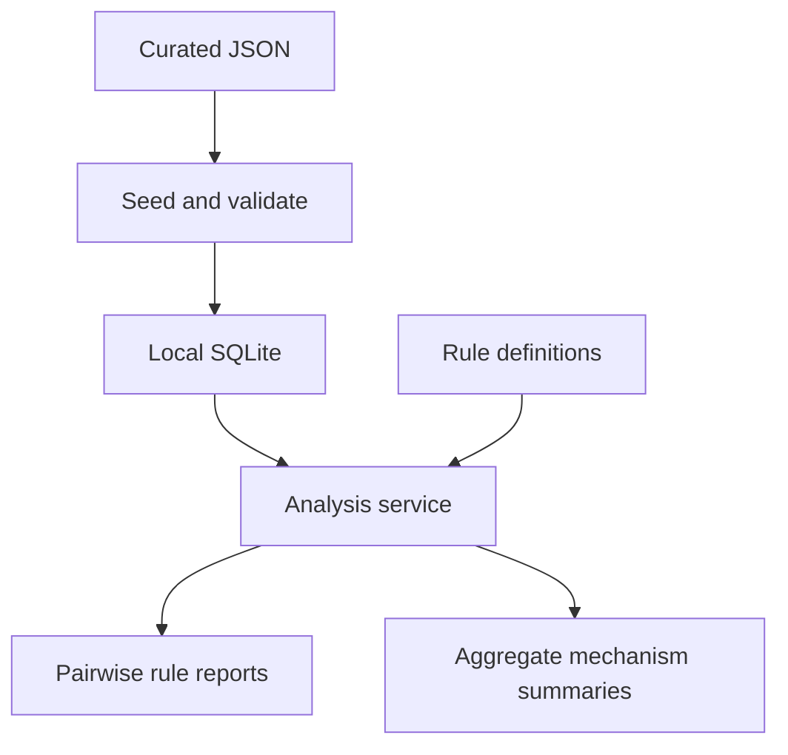

# Architecture

**[Overview](README.md)** · **[Getting started](GETTING_STARTED.md)** · **[Roadmap](ROADMAP.md)**

PharmDS has a curated data layer, a generated SQLite database, two analysis paths, and three ways to use the results. The pairwise rule engine and the newer mechanism pipeline both run today; their responsibilities are distinct.

## System at a glance

| Entry point | Code | Role |
| :--- | :--- | :--- |
| Browser | `web/` → `api/` | React and Vite interface; development proxy sends `/api` to port 8010. |
| HTTP API | `api/main.py` | Drug metadata, analysis, and health routes; `/docs` shows the API reference. |
| Command line | `app/cli/` | Analyze named substances and inspect detail or JSON output. |
| Desktop editors | `tools/curation_gui.py`, `tools/curation_studio.py` | Edit and validate the same curated JSON, with backup behavior. |

`app/service.py` coordinates analysis for the interfaces. The API root `/` does not serve the browser app.

## Sources of truth

| Input | Responsibility | Derived or local output |
| :--- | :--- | :--- |
| `data/curation/drugs.json` | Drug facts, routes, release types, and sourced strength options. | Drug rows and related facts in SQLite. |
| `data/curation/pk_observations.json` | Source specific PK measurements and study context. | PK observation rows in SQLite. |
| `data/evidence/` | Structured source records and evidence claims. | Evidence available to curation and analysis. |
| `rules/rule_defs/` | Explicit interaction rules and their references. | Loaded rule objects at analysis time. |

Curation manifests and backfill files under `data/curation/` are inputs for import and review workflows. `reference/expanded_*.json` and `evidence_gap_report.json` are generated snapshots and reports. **`data/pharmds.sqlite3` is a generated read model, not the place for durable edits.** Both `data.seed_sqlite` and pytest delete and rebuild it from curation inputs.

The two desktop editors share these source files. Each editor reads its own copy when launched, so simultaneous edits to the same medication can conflict.

## How an analysis is built

| Stage | Owner | Output |
| :--- | :--- | :--- |
| Resolve input and load facts | `app/` and `data/` | Drug IDs, structured facts, and optional regimen information. |
| Evaluate established interactions | `rules/` and `reasoning/` | Directional PK and PD hits, severity, actions, references, detailed pair reports, and regimen summaries. |
| Normalize and aggregate mechanisms | `core/mechanisms/` | Candidates, arbitration, concern policy, aggregate evidence, and educational summaries. |
| Assemble public result | `app/service.py` | Aggregate summaries followed by established pairwise rule summaries. |

The mechanism pipeline does not modify pairwise rule decisions. A future handoff of any behavior should be checked against the existing pairwise and audit tests before the old ownership is removed.

### Product strength, observed PK, and regimen input

| Concept | Describes | Does not imply |
| :--- | :--- | :--- |
| Product strength | Labeled content of a particular dosage form and release type. | What a person actually administered. |
| PK observation | A reported measurement with source, analyte, population, dose or conditions where stated, and statistic. | One universal value for all formulations or patients. |
| Regimen input | An explicitly supplied dose and timing schedule. | A dose inferred from the selected strength. |

Educational timing calculations use only eligible half life observations. See [PK observations](docs/pk_observations.md) and [regimen timing](docs/regimen_timing.md) for the data model and its limits.

## Verification boundary

Data and rule changes need curation validation, rule tests, and negative cases. The test suite also covers pairwise parity, mechanism output, and API contracts. Four audit Markdown files under `docs/audits/` are test baselines; the [Getting Started guide](GETTING_STARTED.md#find-the-right-document) identifies them. For commands, use the [checklist](GETTING_STARTED.md#check-your-changes).
