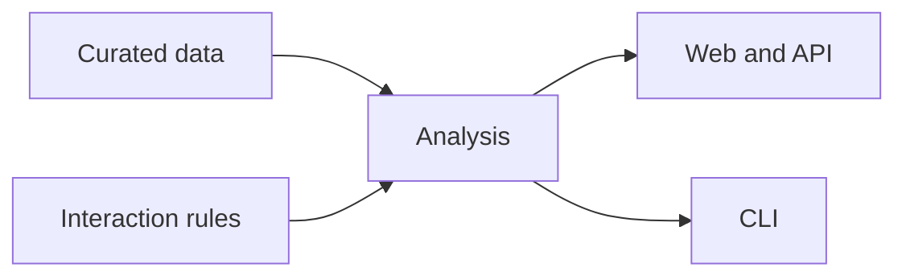

# PharmDS

### An inspectable PK/PD interaction explorer

PharmDS brings curated drug facts, sourced product strengths, PK observations, and explicit interaction rules into one educational workspace. Explore a medication list in the browser, inspect pairwise explanations, or curate the underlying data with desktop tools.

> [!IMPORTANT]
> **Educational use only.** PharmDS is not a prescribing, diagnostic, or patient specific decision tool.

**[Get started](GETTING_STARTED.md)** · **[Architecture](ARCHITECTURE.md)** · **[Roadmap](ROADMAP.md)** · **[Safety](docs/safety.md)**

## What you can explore

| Interaction view | What it shows | Where to look |
| :--- | :--- | :--- |
| **Pharmacokinetics** | Directional enzyme and transporter rules, with the affected and interacting substances identified. | Pairwise results and sourced PK observations |
| **Pharmacodynamics** | Shared effects and explicit pair rules for additive or opposing effects. | PD effects and pairwise explanations |
| **The full regimen** | Pairwise hits plus aggregate educational summaries across a medication list. | Analysis results and regimen summary |
| **Product details** | Route, release type, dosage form, and sourced strength options. | Drug catalog and curation editors |

Strength options describe **what a product contains**. They do not establish the dose a person takes. PK measurements retain their source and study conditions rather than becoming a universal value for a substance.

## Pick a starting point

| I want to… | Start here |
| :--- | :--- |
| **Run the web app** | Follow the [Windows setup and two terminal launch](GETTING_STARTED.md#run-the-web-app). |
| **Analyze from a terminal** | Use the [CLI example and options](GETTING_STARTED.md#analyze-from-a-terminal). |
| **Add or review medications** | Open the [curation editors](GETTING_STARTED.md#curate-medications). |
| **Understand a result** | Read the [analysis paths](ARCHITECTURE.md#how-an-analysis-is-built). |
| **See what comes next** | Review the [priority board](ROADMAP.md#priority-board). |

## Project map

| Directory | Purpose |
| :--- | :--- |
| [`data/`](data/) | Canonical curation, evidence records, and the generated local SQLite database. |
| [`rules/`](rules/) and [`core/mechanisms/`](core/mechanisms/) | Established pairwise rules and the newer aggregate mechanism pipeline. |
| [`api/`](api/), [`app/`](app/), [`web/`](web/) | HTTP interface, service and CLI, and browser interface. |
| [`tools/`](tools/) and [`docs/`](docs/) | Desktop curation tools and maintainer guidance. |

The [Getting Started guide](GETTING_STARTED.md) has setup commands, URLs, local data cautions, and test commands. [ARCHITECTURE.md](ARCHITECTURE.md) explains ownership between the two analysis paths. [ROADMAP.md](ROADMAP.md) tracks priorities without promising release dates.

PharmDS is for learning and software exploration. See the [full disclaimer](DISCLAIMER.txt) and [project scope](docs/scope.md).
